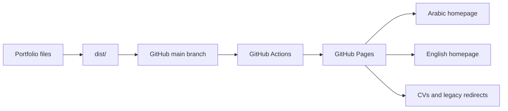

<div align="center">

# MYZ Portfolio V1.0

Data Science student portfolio focused on data analysis, business intelligence, and applied AI.

[Arabic Website](https://malzobaidy0-boop.github.io/my-portfolio/) · [English Website](https://malzobaidy0-boop.github.io/my-portfolio/en.html)


</div>

## Overview

MYZ Portfolio is a bilingual personal portfolio for Mohammed Yasin Al-Zubaidy. It presents his Data Science studies, technical interests, selected work, CVs, and professional contact links through a minimal responsive interface.

Arabic is the default homepage; the English version is available at `en.html`.

## Features

- Arabic RTL and English LTR pages
- Responsive mobile, tablet, and desktop layouts
- Original MYZ fingerprint monogram and minimal visual system
- Collapsible sidebar navigation
- Grouped Technical Skills section with compact tags
- 30-second professional summary dialog
- CV buttons for Arabic and English PDF files
- Email, LinkedIn, and GitHub contact links
- Verified Abu Al-Abd Pizza & Manousheh menu link
- Legacy redirects for previously published homepage, CV, works, and bakery paths
- Inactive placeholders for unavailable projects and design work

## Technical Implementation

- Semantic HTML5 with inline SVG icons
- Custom CSS responsive breakpoints and RTL support
- Vanilla JavaScript for the sidebar, collapsible groups, and summary dialog
- Relative paths for GitHub Pages compatibility
- GitHub Actions deployment from `dist/`
- No frontend framework or package dependency

## Deployment Architecture



## Repository Structure

```text
.
├── .github/workflows/static.yml
├── dist/
│   ├── index.html          # Arabic homepage
│   ├── en.html             # English homepage
│   ├── index-ar.html       # Arabic legacy redirect
│   ├── resume.html         # English CV redirect
│   ├── resume-ar.html      # Arabic CV redirect
│   ├── works.html          # English works redirect
│   ├── works-ar.html       # Arabic works redirect
│   ├── bakery/index.html   # Bakery URL redirect
│   └── assets/
│       ├── CV_AR.pdf
│       ├── CV_EN.pdf
│       ├── menu.js
│       └── style.css
├── scripts/sync_drive.py
└── README.md
```

`dist/` is the deployment root configured by `.github/workflows/static.yml`.

## Local Development

From the repository root, start a local static server:

```bash
python -m http.server 8000 --bind 127.0.0.1 --directory dist
```

Open `http://127.0.0.1:8000/` for Arabic or `http://127.0.0.1:8000/en.html` for English.

## Release Status

V1.0 is deployed to [GitHub Pages](https://malzobaidy0-boop.github.io/my-portfolio/) from `main`.

Release validation covered both languages, CV and contact links, the bakery link, legacy redirects, relative assets, privacy scanning, and responsive layouts at 375px, 768px, 1024px, and 1440px.

## What I Learned

- Maintaining consistent content and navigation across Arabic RTL and English LTR pages
- Building responsive HTML and CSS layouts across mobile and desktop viewports
- Adding lightweight navigation and summary interactions with vanilla JavaScript
- Preparing and validating a static GitHub Pages release

## Future Roadmap

- [ ] Add completed technical projects as they become available
- [ ] Replace inactive project placeholders with verified project links
- [ ] Expand technical project documentation
- [ ] Add selected design work when ready
- [ ] Keep portfolio and CV information current

## Author

<div align="center">

**Mohammed Yasin Al-Zubaidy**<br>
Data Science Student | University of Jeddah

[Portfolio](https://malzobaidy0-boop.github.io/my-portfolio/) · [LinkedIn](https://www.linkedin.com/in/mohammed-al-zubaidy-68a7a2292/) · [GitHub](https://github.com/malzobaidy0-boop)

</div>
